# CISSP Interactive Mindmap & Study Companion

**An interactive study companion for the CISSP exam.** Explore every domain as a zoomable mindmap, track what you've covered, keep your own notes next to every topic, drill flashcards, take practice tests, and follow a study plan that counts down to your exam date.

### 👉 Live at **[mindmap.sajinshivdas.online](https://mindmap.sajinshivdas.online)**

No sign-up and no account. Everything you add stays in your own browser.

  

### 📑 Feature tour (slides)

The 15-slide visual walkthrough shows every feature in dark and light mode. Click the cover to open the PDF.

  <a href="docs/CISSP-Mindmap-carousel.pdf">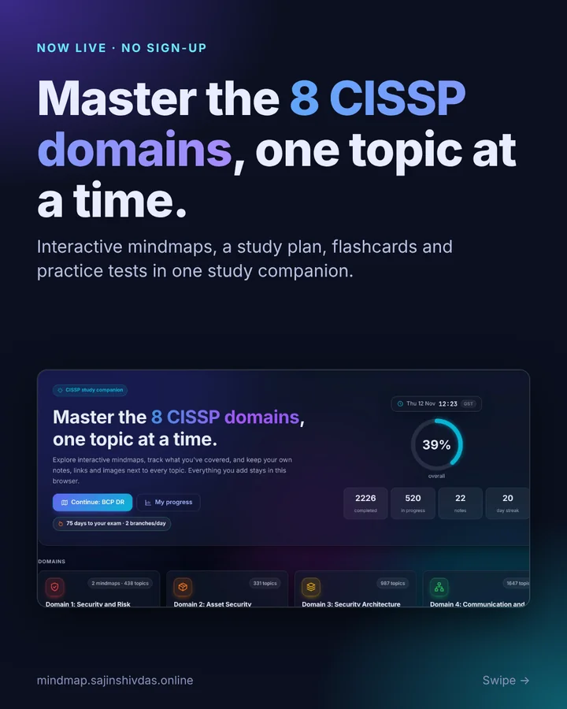</a>

---

## Contents

- [Why this exists](#why-this-exists)
- [At a glance](#at-a-glance)
- [Home](#home)
- [Domain pages and the Study Hub](#domain-pages-and-the-study-hub)
- [Flashcards and quizzes](#flashcards-and-quizzes)
- [Interactive mindmaps](#interactive-mindmaps)
- [Checklist](#checklist)
- [Study dashboard and exam plan](#study-dashboard-and-exam-plan)
- [Bookmarks, notes and search](#bookmarks-notes-and-search)
- [Backup, restore and device transfer](#backup-restore-and-device-transfer)
- [Guided tours](#guided-tours)
- [Date, time and time zone](#date-time-and-time-zone)
- [Dark and light themes](#dark-and-light-themes)
- [On your phone](#on-your-phone)
- [Keyboard shortcuts](#keyboard-shortcuts)
- [Privacy](#privacy)
- [Tips for using it well](#tips-for-using-it-well)
- [Feedback](#feedback)

---

## Why this exists

The CISSP covers eight broad domains and hundreds of concepts, and the exam expects you to think like a security manager. Most candidates end up with scattered PDFs, videos, bookmarks and notes, and no clear picture of how much they've actually covered.

The companion puts the whole syllabus in one place as mindmaps you can explore. It tracks your progress topic by topic, and it tells you each day what to study next so you're ready by exam day.

## At a glance

| | |
|---|---|
| 🧠 **Mindmaps** | 11 interactive mindmaps covering all 8 CISSP domains, plus memorisation techniques and threats & countermeasures: **5,700+ topics** in all |
| 🔥 **Progress** | Mark every topic *not started / in progress / completed*, and see it as a heat-map on the map |
| 📚 **Study Hub** | Key concepts, key terms, key areas, practice tests and resources for every domain |
| 🃏 **Flashcards** | Flip cards and 10-question quizzes with spaced repetition |
| 📅 **Study plan** | Exam countdown, daily focus, pace, projected finish date and a weighted readiness score |
| 📝 **Your own material** | Markdown notes, reference links and images on any topic, plus bookmarks |
| ✅ **Checklist** | Every topic as a tick-list you can filter and export to Markdown |
| 🔎 **Search** | One search across all topics, your notes and the Study Hub, acronyms included |
| 📱 **Any device** | Works on desktop, tablet and phone. Moves your data between devices with a one-time QR code |
| 🔒 **Private** | No account. Your study data never leaves your browser unless you send it |

---

## Home

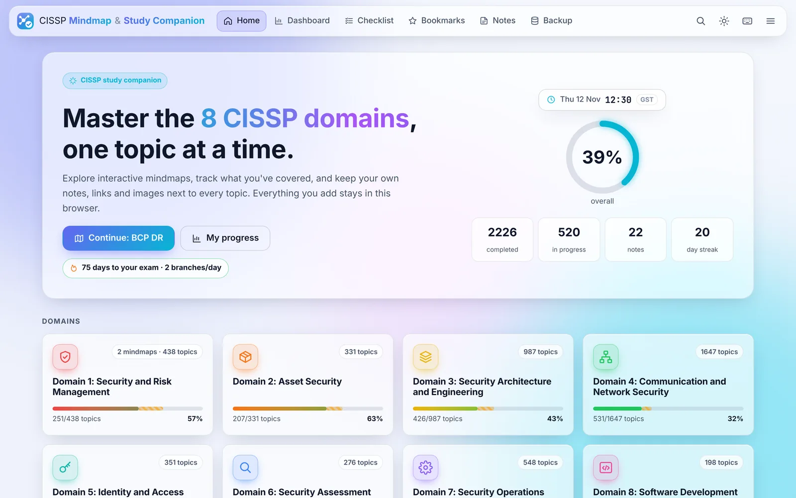

- **Your progress at a glance:** an overall progress ring, plus counts of completed topics, topics in progress, notes and your **day streak**.
- **Continue where you left off:** the main button takes you back to the last topic you opened. On your first visit it reads **Start exploring**.
- **Exam chip:** shows the days left to your exam and how many branches to study each day. Before you set a date, it reads **Set your exam date**.
- **Domain cards:** one card per domain, with its colour, icon, topic count and a progress bar showing completed and in-progress topics.
- **Date and time:** a clock above the progress ring, in your own time zone (see [Date, time and time zone](#date-time-and-time-zone)).

---

## Domain pages and the Study Hub

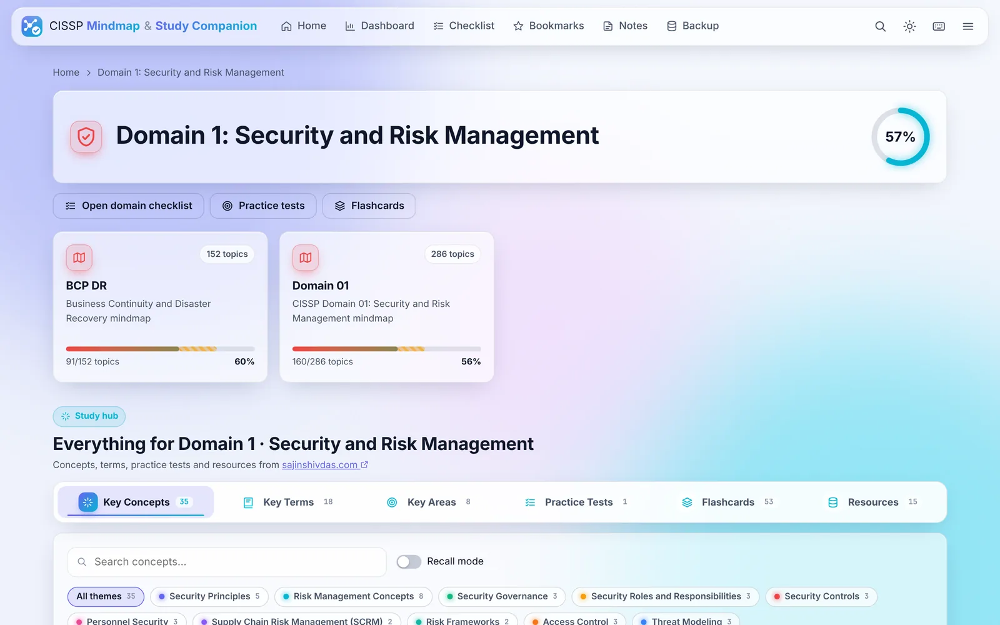

Each domain has its own page with:

- a header showing the domain's progress ring
- buttons for the **domain checklist**, **practice tests** and **flashcards**
- a card for each of the domain's mindmaps, with its own progress bar
- the **Study Hub**: everything else you need for that domain, in six tabs

| Tab | What's in it |
|---|---|
| **Key Concepts** | Concepts grouped by theme, each with its definition. Filter by theme or search. |
| **Key Terms** | An A–Z glossary with letter jumps. Some terms have sub-terms. |
| **Key Areas** | A nested outline of the areas you need to know |
| **Practice Tests** | Practice sets with two modes, plus a full mock assessment covering all 8 domains: **Practice Mode:** feedback after every answer **Assessment Mode:** exam conditions, with a score at the end |
| **Flashcards** | In-page flip cards and quizzes built from the domain's concepts and terms (see below) |
| **Resources** | Recommended books (with chapter references), videos, credits, and mindmap downloads as full-screen viewer, PDF or JPG |

**Recall mode:** in Key Concepts and Key Terms, this hides the definitions so you can test yourself, then reveal them one at a time.

<table>
<tr>
<td width="50%">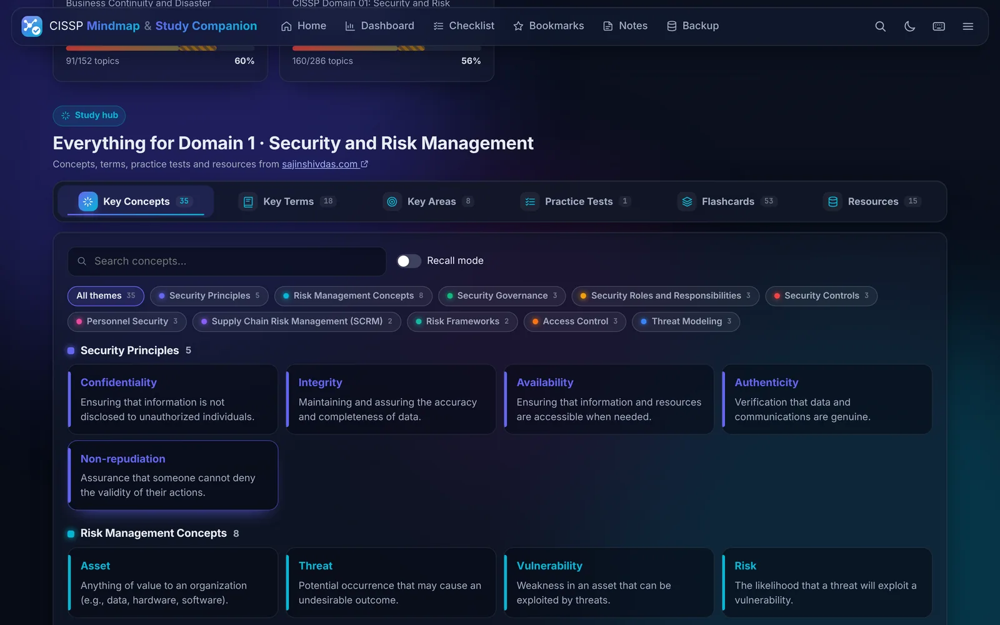 <b>Key Concepts</b>, grouped and filterable by theme</td>
<td width="50%">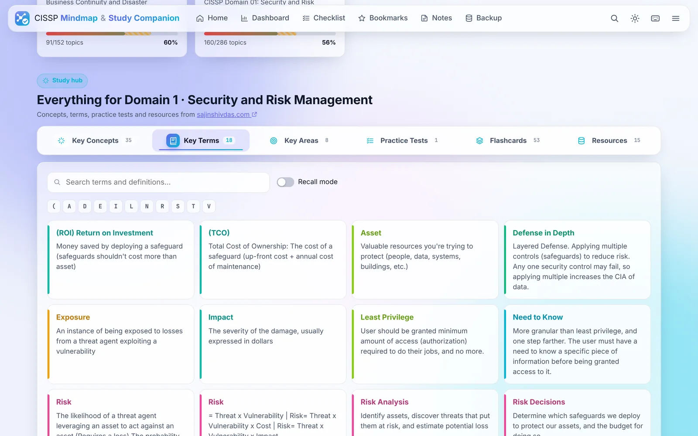 <b>Key Terms</b>, an A–Z glossary with recall mode</td>
</tr>
<tr>
<td> <b>Practice Tests</b> in practice or assessment mode</td>
<td> <b>Resources:</b> books, videos and mindmap downloads</td>
</tr>
</table>

**Deep links:** a link like `/domain/domain-01#terms:risk` opens a tab and searches it straight away, so you can share a term with a study partner.

---

## Flashcards and quizzes

<table>
<tr>
<td width="50%"></td>
<td width="50%"></td>
</tr>
</table>

- **Flip mode:**
  - A session of up to 20 cards.
  - Press <kbd>Space</kbd> to flip a card, then rate yourself **I knew it** (<kbd>2</kbd>) or **Review again** (<kbd>1</kbd>).
- **Quiz mode:**
  - 10 multiple-choice questions with 4 options each.
  - Wrong options never differ from the answer only by an acronym, so every question is fair.
- **New & weak cards:** a deck of only the cards you haven't seen yet or keep missing.
- **Spaced repetition:**
  - A card you know moves up a box, and one you miss goes back to the start.
  - A card counts as **mastered** after you get it right twice.
  - Each deck shows its *new / learning / mastered* counts.
- **Saved:** your flashcard history is kept in your browser and included in backups.

---

## Interactive mindmaps

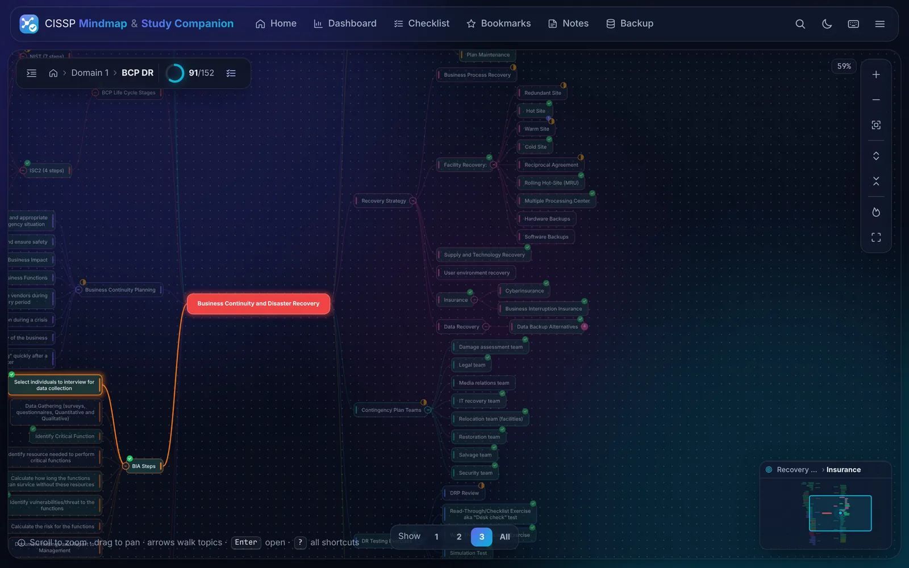

### Moving around
- Drag to pan, scroll to zoom, or pinch on a touch screen. Double-click empty space to zoom in.
- **Toolbar:** zoom in and out, fit to screen, expand all, collapse all, heat-map and fullscreen.
- **Keyboard:** the arrow keys walk the tree. Left and right go to the parent or child, and up and down go to siblings.
- **Distraction-free:** the toolbars fade while you study and come back when you move the mouse.

### Showing more or less
- **Show 1 / 2 / 3 / All:** picks how many levels are visible.
- **Very large maps:** on maps with hundreds of topics, **All** expands only the main branch you're working in, and a **Whole map** button opens the rest. Big maps first open on their main branches.
- **Remembered layout:** each map remembers what you expanded or collapsed.
- **Focus a branch:** press <kbd>Z</kbd> to make a branch the centre of the map, and <kbd>U</kbd> to go back up. The breadcrumb at the top shows where you are, and you can click any part of it.

### Finding things

- **Outline panel** (<kbd>O</kbd>): the whole map as a tree. Press <kbd>/</kbd> to search topic titles and descriptions, with matches highlighted.
- **Minimap:**
  - Click or drag it to move around the map.
  - The **"you are here"** path at its top shows your position in the map, and you can click any part to jump back.
- **Hover:** pointing at a topic highlights its path back to the centre.

### Seeing your progress: the heat-map

Press <kbd>P</kbd> or the 🔥 button. Every topic is shaded by how much of what's under it you've studied:
- six steps of green, from grey (nothing studied) to full green (all done)
- in-progress topics count as half
- a legend shows the scale and the map's total
- the minimap uses the same colours

It's the quickest way to spot the gaps before exam day.

### The topic panel

Click a topic or press <kbd>Enter</kbd> to open its panel:
- **Status:** *not started / in progress / completed* (<kbd>1</kbd> <kbd>2</kbd> <kbd>3</kbd>).
- **Bookmark** (<kbd>B</kbd>).
- **Context:** the topic's description, and its path as clickable crumbs.
- **Subtopics** as chips, each showing its own status.
- **Study Hub matches:** related key terms and concepts, one click away.
- **My notes:**
  - Written in Markdown, so you can use bold, lists and links.
  - Press <kbd>N</kbd> to start one and <kbd>Ctrl</kbd>+<kbd>Enter</kbd> to save it. You can edit and delete notes later.
- **Reference links:** add the articles, standards or videos that helped you.
- **Images:**
  - Upload them, drag them in or paste them, up to 8 MB each.
  - Each image can have a caption and opens full-size in a lightbox.
- **On the map:** topics show a status dot, a ⭐ if bookmarked, and a count of your notes, links and images.

---

## Checklist

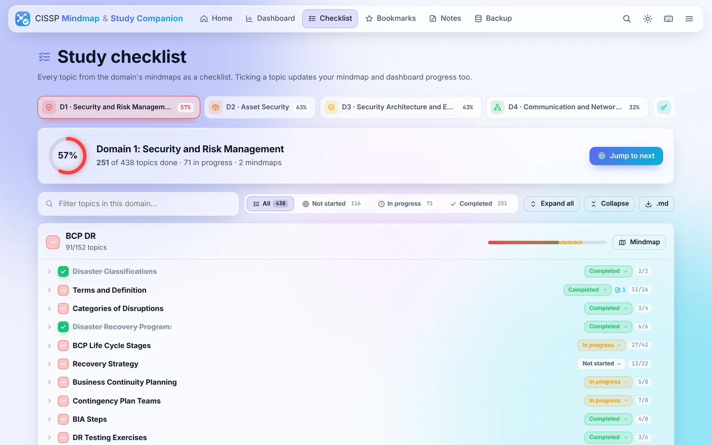

- **What it is:** every topic of a domain as a nested tick-list, with a tab for each domain and a progress ring.
- **Filters:** *All / Not started / In progress / Completed*, with counts, plus a text filter.
- **Status on any row** from a dropdown.
- **Tick a whole branch at once:** ticking a parent row marks everything under it, and **Undo** is offered straight away.
- **Expand or collapse all**, or **export the checklist as a Markdown file** (`.md`).
- **One shared status:** the checklist, the mindmaps, the dashboard and the plan all use the same status for each topic, so ticking something anywhere updates it everywhere.

---

## Study dashboard and exam plan

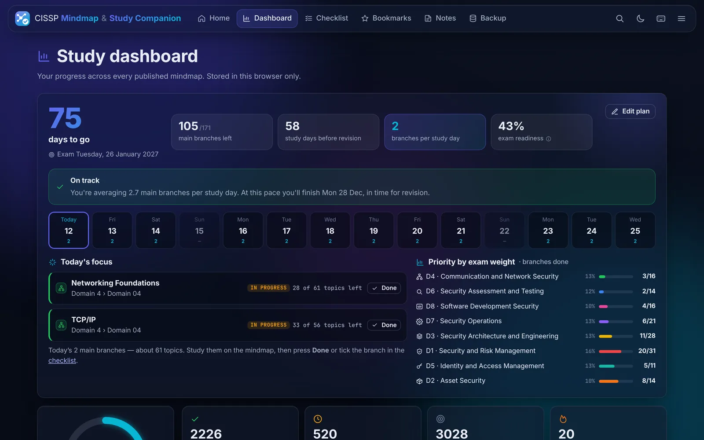

### Study plan and exam countdown
- **Setup:** set your **exam date**, choose which weekdays you study, and pick a **revision buffer** (days kept free before the exam).
- **What it counts:** the plan counts **main branches** (the first-level sections of each mindmap). A branch is done when you mark it completed or finish every topic in it.
- **The numbers:**
  - **Days to go:** the countdown to your exam.
  - **Branches left** and **study days before revision**.
  - **Branches per study day:** what you need to cover each study day to finish in time.
  - **Your pace** and a **projected finish date**, with an **on track / behind pace** status.
  - **Exam readiness:** a score weighted by the official CISSP domain weights, so Domain 1 counts more than Domain 2.
- **The next 14 days:** a strip showing your study days and what's planned for each.
- **Today's focus:** whole unfinished branches to study today, each with **Done** and **Undo**.
- **Priority by exam weight:** domains ordered by how far they lag behind their weight on the exam.

### Your numbers
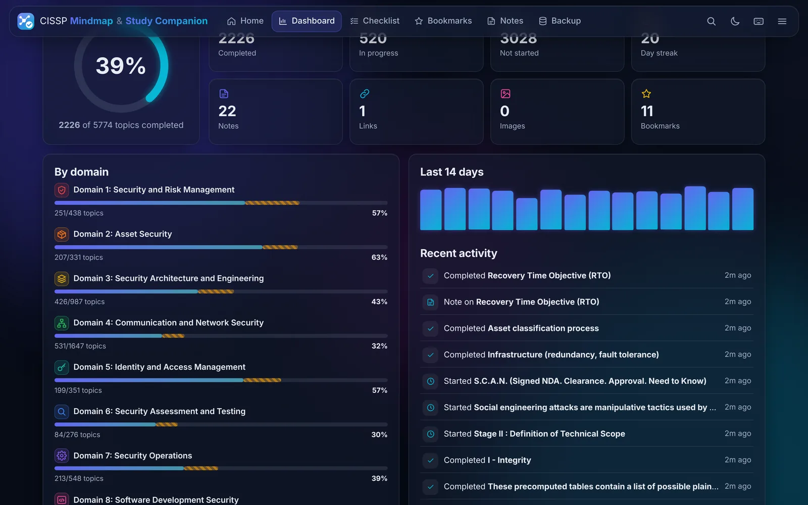

- **Overall:** a ring, plus tiles for completed, in progress, not started, day streak, notes, links, images and bookmarks.
- **Progress by domain:** a bar for each domain.
- **Last 14 days:** an activity chart.
- **Recent activity:** what you completed, started, noted and bookmarked.

---

## Bookmarks, notes and search

<table>
<tr>
<td width="50%"> <b>Bookmarks:</b> every starred topic with its path</td>
<td width="50%"> <b>My notes:</b> all your notes, grouped by mindmap</td>
</tr>
</table>

- **Bookmarks:** every topic you starred, with its path. Click one to jump straight to it on the map.
- **My notes:**
  - All your notes in one place, grouped by mindmap and filterable.
  - If a topic is ever removed from a map, its notes are kept in their own group rather than lost.
- **Search** (<kbd>Ctrl</kbd>+<kbd>K</kbd>, or the 🔍 button):
  - It searches every topic in every map, your own notes, and the Study Hub's concepts, terms and areas.
  - It understands **acronyms**: type `RTO`, `BIA` or `SAML`.
  - Each result shows its status. Use the arrow keys and <kbd>Enter</kbd> to open one.

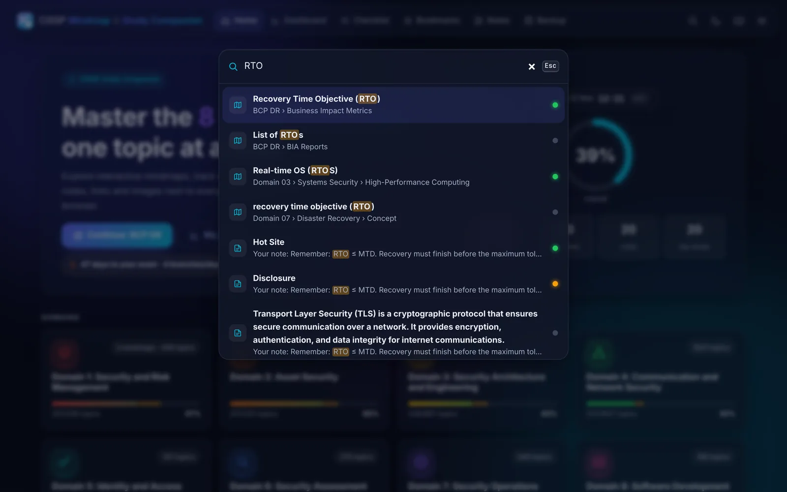

---

## Backup, restore and device transfer

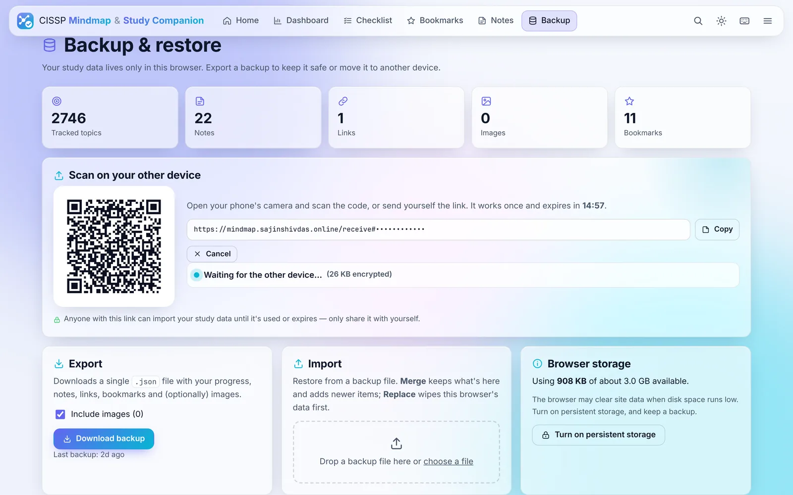

### Send to another device
1. Choose whether to include images, then press **Create a one-time link**.
2. **Scan the QR code** with your phone, or copy or share the link.
3. The other device shows a summary of what's coming and lets you **Merge** it with what's there or **Replace** it.
4. The first device shows **Sent!** when the other device has received it.

**How it's protected:**
- Your data is **encrypted on your device** (AES-256-GCM) before it's uploaded.
- The key travels only inside the link and is never sent to the server.
- The server stores only scrambled data, deletes it the moment it's opened, and otherwise deletes it after 15 minutes.
- You can cancel a link at any time.

### Export and import
- **Export:** download everything as one `.json` file: progress, notes, links, images (optional), bookmarks, flashcard history and your study plan.
- **Import:** **Merge** keeps the newest version of each item, and **Replace** wipes this browser first. You see a summary before anything is changed.

### Storage
- **Storage use:** see how much browser storage you're using.
- **Persistent storage:** turn it on so the browser doesn't clear your data when the disk is low.
- **Backup reminder:** shown if you have real study data and haven't made a backup for 14 days.
- **Erase data:** wipes this browser's study data.

---

## Guided tours

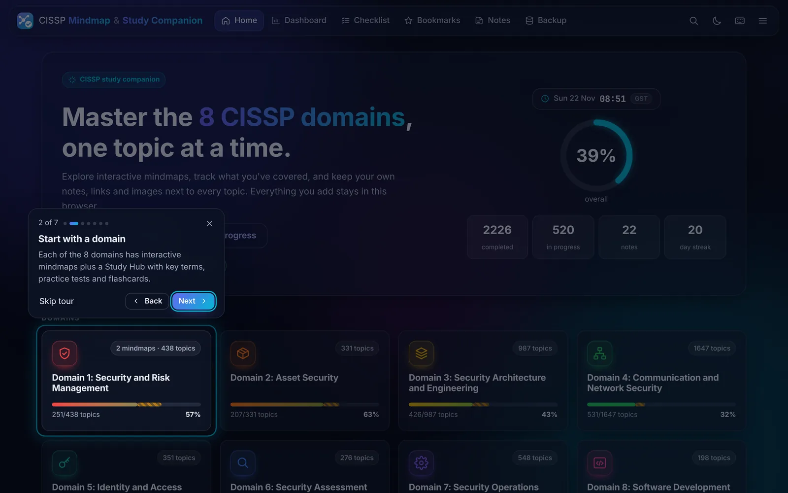

- **Welcome tour:** shown on your first visit to the home page.
- **Mindmap tour:** shown the first time you open a mindmap.
- **How they work:**
  - They dim the page and highlight one control at a time.
  - Move with **Next**, **Back**, the arrow keys, or **Skip** / <kbd>Esc</kbd>.
- **How often:** each tour shows once per device. Replay it any time from the shortcuts window (<kbd>?</kbd>) with **Take the tour** or **Mindmap tour**.
- **On phones:** steps point to the ☰ menu, and steps for hidden controls are skipped.

---

## Date, time and time zone

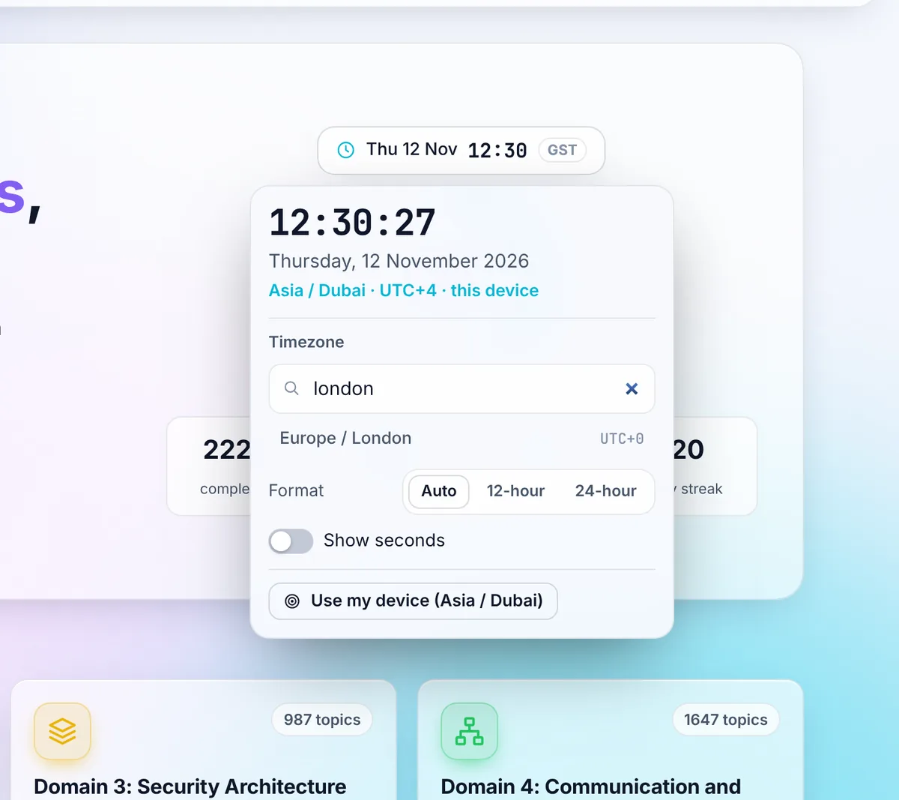

The home page shows the date, time and your time zone above the progress ring. Click it to open a panel with:
- the live time, the full date, and the time zone with its UTC offset
- **time zone search** by city, region or offset, for example `new york`, `kolkata` or `+5:30`
- **12-hour / 24-hour / automatic** format and a **Show seconds** switch
- **Use my device** and **Reset**

Your choices are saved in your browser.

---

## Dark and light themes

<table>
<tr>
<td width="50%"> Dark</td>
<td width="50%"> Light</td>
</tr>
</table>

- **Switching:** press <kbd>T</kbd> or the 🌙 / ☀️ button.
- **Your choice is kept:** the site remembers your theme, and on a first visit it follows your device setting.
- **Built for both:** every screen, chart and the mindmap heat-map are designed for both themes.
- **Reduced motion:** animations are toned down if your device asks for reduced motion.

---

## On your phone

  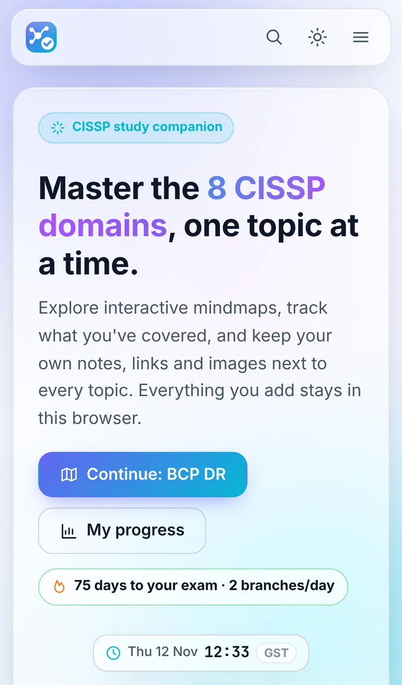
  
  

- **Layout:** works on phones and tablets, with a ☰ menu, touch-friendly controls, and **pinch to zoom** on the mindmaps.
- **Add to home screen:** it opens like an app, with its own icon.
- **Moving between devices:** use [Send to another device](#send-to-another-device) to move your progress from your laptop to your phone and back.

---

## Keyboard shortcuts

Press <kbd>?</kbd> anywhere to see them.

| Group | Keys | Action |
|---|---|---|
| **General** | <kbd>Ctrl</kbd> <kbd>K</kbd> | Search everything |
| | <kbd>T</kbd> | Light / dark theme |
| | <kbd>?</kbd> | Shortcuts (and replay the tours) |
| | <kbd>Esc</kbd> | Close panel / clear selection |
| **Go to** | <kbd>G</kbd> then <kbd>H</kbd> / <kbd>L</kbd> / <kbd>D</kbd> / <kbd>B</kbd> / <kbd>N</kbd> / <kbd>S</kbd> | Home / Checklist / Dashboard / Bookmarks / Notes / Backup |
| **Mindmap** | <kbd>←</kbd> <kbd>↑</kbd> <kbd>→</kbd> <kbd>↓</kbd> | Walk topics: parent, child, siblings |
| | <kbd>Shift</kbd> + arrows | Pan |
| | <kbd>Enter</kbd> / <kbd>Space</kbd> | Open topic / expand or collapse it |
| | <kbd>+</kbd> <kbd>−</kbd> <kbd>0</kbd> | Zoom in / out / fit |
| | <kbd>E</kbd> / <kbd>C</kbd> | Expand / collapse all |
| | <kbd>P</kbd> | Progress heat-map |
| | <kbd>F</kbd> | Fullscreen |
| **Navigate** | <kbd>O</kbd> | Outline panel |
| | <kbd>/</kbd> | Find in this map |
| | <kbd>Z</kbd> / <kbd>U</kbd> | Focus the selected branch / back up one level |
| | <kbd>J</kbd> / <kbd>K</kbd> | Next / previous topic |
| **Open topic** | <kbd>1</kbd> <kbd>2</kbd> <kbd>3</kbd> | Not started / in progress / completed |
| | <kbd>B</kbd> | Bookmark |
| | <kbd>N</kbd>, then <kbd>Ctrl</kbd> <kbd>Enter</kbd> | Write a note, then save it |
| **Flashcards** | <kbd>Space</kbd>, then <kbd>1</kbd> / <kbd>2</kbd> | Flip, then "review again" / "I knew it" |
| **Quiz** | <kbd>1</kbd>–<kbd>4</kbd>, <kbd>Enter</kbd> | Pick an answer, next question |

---

## Privacy

- **No account and no sign-up.** You start studying straight away.
- **Your study data stays in your browser:**
  - Progress, notes, links, images, bookmarks, flashcard history and your study plan are stored in your own browser (IndexedDB).
  - None of it is sent to a server.
- **Small preferences** such as your theme, open panels, expanded branches and tours already seen are kept in your browser too.
- **Device transfer is end-to-end encrypted:**
  - The key exists only in the link you share, so the server can never read your data.
  - The transfer is deleted on first use or after 15 minutes.
- **Anonymous visit counts only:**
  - The site counts page views and which features are used, to see what's helpful.
  - It uses **no cookies** and stores no IP addresses or identifiers.
  - It never sends anything you type, your notes or your progress.
  - **Do Not Track** and **Global Privacy Control** are respected.
- **The newsletter is optional:** the only personal data the site keeps is an email address you choose to enter in the footer's subscribe form.

> Because your data lives in your browser, clearing your browser's site data erases it. Use **Backup → Download backup** now and then, or turn on **persistent storage**.

---

## Tips for using it well

1. **Set your exam date first** (Dashboard → set up the plan). The rest of the site then tells you what to study each day.
2. **Work branch by branch.** Open today's focus, study it on the mindmap, and mark it done.
3. **Use the heat-map weekly** (<kbd>P</kbd>) to find the domains you've been avoiding.
4. **Write notes in your own words.** Notes in your own words stick better than highlighting. Add the exam tip or mnemonic that worked for you.
5. **Drill the weak cards.** The *New & weak cards* deck brings back exactly what you keep missing.
6. **Take a practice test in Assessment Mode** once a domain is mostly green.
7. **Back up or send your data to your phone** so you can revise anywhere.

---

## Feedback

Suggestions, corrections and ideas are welcome. Please [open an issue](https://github.com/ShivdaSaj/CISSP-Interactive-Mindmap-Study-Companion/issues) in this repository.

If the companion helps you, share it with someone else preparing for the CISSP. 🙌

CISSP is a registered certification mark of ISC2, Inc. This is an independent study aid and is not affiliated with or endorsed by ISC2.
